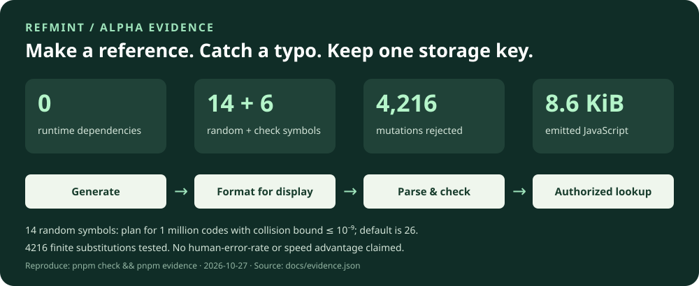

# RefMint

**Reference codes you can generate, print and check.**

[](https://github.com/PerchAnton/refmint/actions/workflows/ci.yml)


[](https://github.com/PerchAnton/refmint/releases/tag/v0.1.0-alpha.3)
[](https://www.npmjs.com/package/refmint)

RefMint is a small TypeScript library for public ticket, document and order references. It can generate random references or encode existing uint64/UUID values with a namespace and a standard Bech32m checksum. A form can distinguish a mistyped code from a valid reference for a different record type, before querying a database.

**New in alpha.3:** a PDF/phone lookup experiment comparing existing identifiers, a simple alias and RefMint; 54 selected fixture cases and guidance on when another reference is unnecessary. Runtime JavaScript and the frozen v1 format are unchanged from alpha.2. [Workflow demo](docs/workflows.md) · [When not to use RefMint](docs/when-not-to-use.md).

**Retained from alpha.2:** preserve an existing uint64 or UUID with `createReferenceCodec`, inspect invalid input with `diagnose`, and load only the codec with `refmint/codec`. The release includes the optimized implementation and comparison evidence; the tagged source includes the complete comparison form. [Format v1](docs/format-v1.md) · [Comparison and measured trade-offs](docs/comparison.md).

**Alpha:** APIs may evolve. The existing-ID v1 wire contract is frozen; incompatible formats require a new version. Install the [npm alpha](https://www.npmjs.com/package/refmint), [download the GitHub prerelease](https://github.com/PerchAnton/refmint/releases/tag/v0.1.0-alpha.3), or build from source. The package uses ES modules and includes TypeScript declarations. Node.js 22+ and browsers with Web Crypto are the targets.



The image is generated from [recorded evidence](docs/evidence.json). See [measurement methods](docs/evidence.md); detection counts are code tests, not a human transcription study.

## Try it

**Already have an ObjectId, invoice number or working search? Keep it unless an
observed manual-entry problem justifies another representation.** RefMint does
not make database lookup faster or authorize access. The built-in existing-ID
codecs support uint64 and UUID, **not MongoDB ObjectId**. A separate random alias
for ObjectId needs a stored field or mapping, a unique index, collision handling,
backfill and lifecycle maintenance. The uint64/UUID codecs can avoid that mapping,
but still add UI, dependency and compatibility work.
[Adoption decision and costs](docs/adoption.md).

**No human-entry advantage is established.** Selected typo mutations and codec
timings cannot show that people are faster or make fewer errors. Compare the
existing workflow, a simple alias and RefMint with real participants before making
that claim; retain failures and report manual entry separately from copy/paste.
[Measurement protocol](docs/manual-entry-study.md).

The package remains alpha. Frozen v1 wire encoding is narrower than stable APIs,
support or application readiness. [Criteria for a stable release](docs/stability.md)
are separate from the decision to adopt: a stable release alone would not create
a need for integration.

**Would an extra reference help?** Try the
[PDF/phone lookup experiment](docs/workflows.md): existing number or hostname,
five-character alias, and RefMint on the same records. The sample fleet code is
49 printed characters versus an 8-character hostname; the invoice code is 21 versus
a 15-character invoice number. The checksum rejects selected typos, but no human-entry
advantage has been established. [When RefMint is unnecessary](docs/when-not-to-use.md).

Install the current alpha from npm:

```sh
npm install refmint@alpha
```

To pin this release, use `npm install --save-exact refmint@0.1.0-alpha.3`. This is a prerelease even when the `latest` registry tag resolves to it; npm availability does not make its API stable. Registry installation does not require an npm account or the URL-dependency flag below.

The GitHub package archive remains available as an alternative:

```sh
npm install --allow-remote=root https://github.com/PerchAnton/refmint/releases/download/v0.1.0-alpha.3/refmint-0.1.0-alpha.3.tgz
```

npm 12 requires explicit permission for URL dependencies. Pass `--allow-remote=root` on later `npm install` / `npm ci` runs for a project that keeps this URL dependency, too; the flag does not change global settings. Alternatively, download the `.tgz` asset and run `npm install ./refmint-0.1.0-alpha.3.tgz`. [npm's URL dependency setting](https://docs.npmjs.com/cli/v12/commands/npm-install/#allow-remote).

The release also includes `SHA256SUMS.txt`, verification metadata and all three measured-evidence reports. To run the local browser demo from the tagged source:

```sh
git clone --branch v0.1.0-alpha.3 https://github.com/PerchAnton/refmint.git
cd refmint
# Install pnpm 11.25.0 if it is not available.
npm install -g pnpm@11.25.0
pnpm install --frozen-lockfile --ignore-scripts
pnpm check
pnpm example
pnpm demo
```

Open **http://127.0.0.1:4173**. The example runs locally, keeps one sample ticket in memory, and demonstrates three outcomes: found, mistyped and valid-but-unknown. It sends no references to a remote service.

To build your own package archive, run `pnpm pack --pack-destination artifacts`, then install that `.tgz` with your package manager. Alpha.3 uses the same verified package archive for npm and GitHub; registry and release pages confirm publication status. Previous alpha.2 archives remain unchanged. Timing results below were measured for alpha.2 and are retained because runtime hashes are identical; this release makes no new performance claim.

## One namespace, one storage format

```ts
import { createReferences } from 'refmint'

const tickets = createReferences({
  prefix: 'ticket',
  expectedCount: 1_000_000,
  maxCollisionProbability: 1e-9
})

const id = tickets.generate()               // canonical lowercase string
const printed = tickets.format(id)         // groups of four after the prefix
const result = tickets.parse(printed.toUpperCase())

if (result.ok) {
  // Query using result.id, then apply your application's authorization rules.
  console.log(result.id)
} else {
  console.log(result.error)                 // e.g. 'checksum' or 'prefix'
}
```

For that budget the random payload has **14 characters / 70 bits**. The six checksum characters and prefix do not add randomness. Its collision probability upper bound is approximately **4.24 × 10⁻¹⁰**, assuming independent, uniform generation across **all issuers combined** over the namespace's lifetime.

If no budget is supplied, RefMint uses **26 random characters / 130 bits**. Choose an explicit `randomLength` to restore a stored configuration. Persist the prefix and payload length with your schema: changing them changes which references that factory accepts. Do not recompute lengths from the current database row count.

## What it catches

| Input | Result |
| --- | --- |
| Canonical reference | Valid; unchanged storage key |
| Whole code in uppercase; exact groups of four | Valid; normalized to the same storage key |
| Mixed case, an unsupported character or broken grouping | Rejected |
| Unicode lookalikes such as `K` in place of `K` | `character`; never silently converted to ASCII |
| A payload or prefix change without recomputing the checksum | Rejected when the checksum detects the error |
| Valid reference generated for another prefix | `prefix` |
| Valid reference with a different payload length | `length` |
| Valid reference not present in your database | Format passes; your lookup reports not found |

`parseCanonical()` requires the exact stored lowercase representation. `parse()` only normalizes documented presentation differences; it never guesses a corrected ID, changes `O` to `0`, or removes arbitrary punctuation. [Full parsing and error rules](SPEC.md).

TypeScript also distinguishes `Reference<'ticket'>` from `Reference<'doc'>`. A plain string must pass the parser before it can be used as a branded reference. The brand is a compile-time aid, not an authorization boundary.

## Keep an existing ID

Available in alpha.2. It does not allocate another random ID or require an alias column:

```ts
import { createReferenceCodec } from 'refmint/codec'

const returns = createReferenceCodec({ prefix: 'rma', kind: 'uint64', version: 1 })
const printed = returns.format(returns.encode(123456n))
const result = returns.diagnose(printed.toUpperCase())
if (result.ok) {
  console.log(result.value) // 123456n — query the original key, with authorization
} else {
  console.log(result.error, result.details) // positions / expected / actual, when known
}
```

For UUIDs, use `kind: 'uuid'` with canonical lowercase UUID strings. A numeric codec requires `bigint` and preserves all 64 bits; it does not preserve leading zeros in a text identifier. Encoding is reversible and does not hide sequential numbers. [Full contract, diagnostics and compatibility](docs/format-v1.md).

The `refmint/codec` entry keeps the random generator and collision planner out of existing-ID-only forms. The same codec remains exported from `refmint`; both paths share its implementation and TypeScript brands. Both entry points are included in the alpha.2 archive; alpha.1 retains only the original random-reference API.

`createReferences(...).diagnose(input)` adds the same diagnostics for existing random references. Its `parse`/`parseCanonical` results and accepted formats remain unchanged. The new v1 grammar includes an underscore and version/kind symbols, so neither API mistakes the other format for one of its IDs.

Run `pnpm compare && pnpm demo`, then open **http://127.0.0.1:4173/comparison/**. Both forms use the same checksum and accept the same cases. The comparison records adapter code, total loaded JavaScript, reference lengths and local timings—including costs that favor the plain Bech32m solution. [Methods, source and limitations](docs/comparison.md). The extra checking does not make codes shorter; no human-entry advantage is established.

After optimization, the form loads **8,773 bytes** of RefMint JS plus adapter, versus **9,327 bytes** for Bech32m plus adapter. Summed per-file gzip still favors Bech32m: **3,353 vs 3,160 bytes**. The full RefMint root import is **14,147 bytes**, down from 15,255. These are unminified module totals, not bundle or install-archive sizes; RefMint's build now removes JS implementation comments while keeping source and declaration documentation.

A same-process Node 24 / Apple M3 run of the same 28 scenarios measured **1.78 million checks/s** after optimization, **0.56 million** before, and **0.82 million** for Bech32m plus adapter. This is a local diagnostic workload, not a general speed guarantee. All **123,146 differential comparisons** against the previous implementation matched. [Raw samples, source hashes and reproduction](docs/comparison.md#before-and-after-optimization).

## Scope and trade-offs

Use RefMint when **people enter a public reference** and your application needs consistent generation, display and validation rules. Keep a **UNIQUE database constraint**, handle collisions with bounded retries, and authorize every lookup. The checksum is public and can be recomputed by anyone: it is not a signature, password, invitation secret or proof of authenticity.

| Need | Consider |
| --- | --- |
| Compact general-purpose random IDs | [Nano ID](https://github.com/ai/nanoid) |
| Typed UUIDv7 identifiers and time ordering | [TypeID](https://github.com/jetify-com/typeid) |
| A human-oriented alphabet and check digit across languages | [HardGuard25](https://github.com/snapsynapse/hardguard25) |
| A public-reference workflow with a declared collision budget and strict storage parsing | RefMint |

RefMint has six checksum characters of overhead and does not sort by time. It makes no general speed advantage, adoption, reduced support cost or human-error-rate claim. Readable formatting and checksums already exist in other projects; this package's contribution is the focused API and tested workflow. Runtime code is independent of Nano ID. The checksum follows [BIP-173](https://github.com/bitcoin/bips/blob/master/bip-0173.mediawiki) / [BIP-350](https://github.com/bitcoin/bips/blob/master/bip-0350.mediawiki), with attribution in [third-party notices](THIRD_PARTY_NOTICES.md).

## Verify and measure

```sh
pnpm check                 # build, standard vectors, independent oracle, mutation + type tests
pnpm example               # actual lookup example
pnpm test:demo             # malformed HTTP requests and the demo asset allowlist
pnpm evidence              # regenerate measured evidence and the SVG above
pnpm compare               # measure the existing-ID form against a Bech32m adapter
pnpm test:comparison       # verify the recorded comparison facts and source hashes
pnpm test:package          # offline install of the .tgz, API + types + documentation checks
pnpm exec playwright install chromium firefox webkit
pnpm test:browser          # actual form flow in three browser engines
pnpm pack --pack-destination artifacts
```

CI runs the core checks on Node 22, 24 and 26, including Windows and macOS, plus the browser example on Chromium, Firefox and WebKit. The workflow badge reports its current result; the release notes link the checks for the released commit. See [SPEC.md](SPEC.md), [CHANGELOG.md](CHANGELOG.md), [security policy](SECURITY.md) and [contribution guide](CONTRIBUTING.md).

The package check first plants an obsolete build file and verifies that a clean build removes it. It then installs into a separate consumer with an empty dependency store and network access disabled for installation, checking the archive contents, exported API, namespace types, shipped documentation links and runtime hashes against the recorded evidence. npm prereleases use the `alpha` tag. See the [publication checklist](CONTRIBUTING.md#publishing-an-alpha) for release verification.

Boundary tests cover all **912** supported prefix/payload length pairs and **1,766** count/budget pairs near floating-point cutoffs. The budget oracle compares exact integer ratios, including subnormal targets and impossible budgets. These checks validate the stated rules; they do not measure human error rates.

## License

Original code: **MIT OR Apache-2.0**, at your option. Standard checksum/reference attribution and separately licensed test vectors are recorded in [THIRD_PARTY_NOTICES.md](THIRD_PARTY_NOTICES.md).
